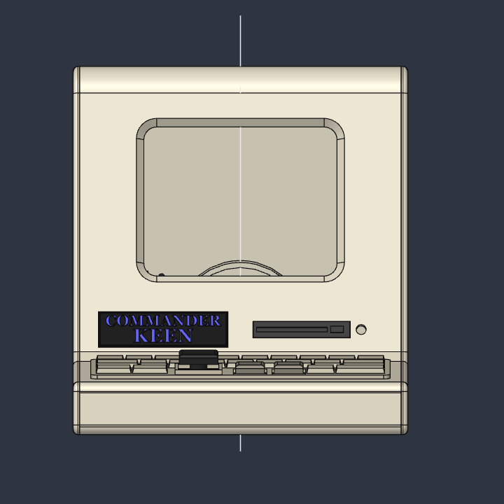
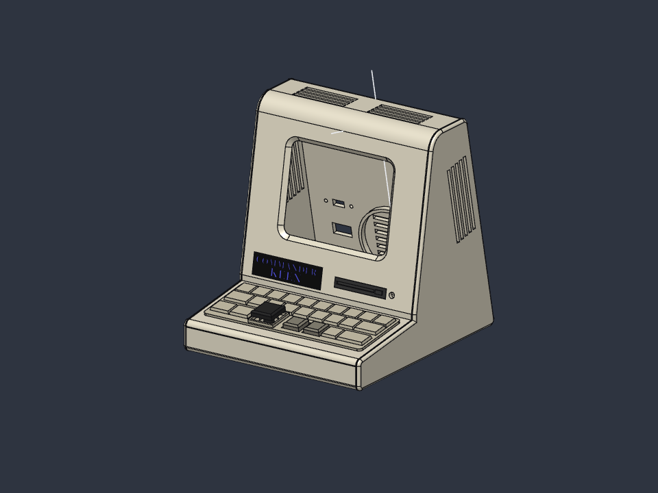

# CRT all-in-one case

A 90s beige all-in-one computer (CRT plus keyboard) for the same hardware as
the Galagino cabinet: CYD, control board, speaker, USB-C socket and slide
switch. The keyboard holds the control board. Its keys are decorative; only
the joystick and the two square keys are real.

 

- Design file: [cad/keen-crt-landscape.sc](../cad/keen-crt-landscape.sc) (SolidCraft; every shell size is a named parameter. The dark detail parts are placed at the current values of `deck_ang`, `face_ang` and `H_front`; if you change those, move the detail parts too)
- Print files: [cad/print-crt/](../cad/print-crt/)
- Firmware: landscape, `pio run -e cyd -t upload`
- Size: 104 × 117 × 114 mm (W × D × H)

## Parts to print

PLA, 0.2 mm layers, no supports. The STLs are exported where the part sits in the
assembled case (the Bezel tilted 10°, the Deck 8°, …), so lay each part onto the
face named below in the slicer ("place on face").

| File | Colour | Print orientation |
|---|---|---|
| SideLeft, SideRight | cream white | outside face down (rabbets and pegs face up) |
| Bottom | cream white | outside face down |
| Front | cream white | inside face down |
| Deck | cream white | outside (top) face down |
| Bezel | cream white | front face down |
| Top | cream white | outside face down; the front rounding gives a short overhang on the first few layers |
| Back | cream white | outside face down |
| KeyField | light beige (a shade darker than the case) | plate down |
| KeyCap1, KeyCap2 | warm grey | flange down |
| JoyCap | black | top down |
| FloppyInsert | charcoal | back face down |
| Badge + BadgeText | black plate, Keen-blue text | plate down, text up. Two colours in one print: load `Badge-2colour.3mf` (multi-colour printer), or print `Badge.stl` + `BadgeText.stl` together and change filament at 1.6 mm (where the plate ends and the letters start) |
| Foot (print 4) | TPU, any colour (black in the renders) | flat side down (chamfer up); 9.6 mm disc, 3 mm tall: 1 mm sits in the recess, 2 mm stands proud. Press in, a drop of CA glue holds it |

The design also holds two display-only bodies for renders, `RenderScreen` (screen glass), the
`RenderScreenImage` mesh (a level 1 frame as coloured pixel tiles, so ray-traced renders show it) and `RenderLED` (green power LED). They are not printed.

## Hardware

| Part | Qty |
|---|---|
| M3 self-tapping screw, 5 mm (CYD to Bezel; the pilots are 4 mm deep blind holes) | 4 |
| M2 self-tapping screw, 6 mm (control board to Deck) | 4 |
| M2 self-tapping screw, 8 mm (back hatch) | 2 |
| M2 self-tapping screw, 3 mm (slide switch to Back, from inside) | 2 |
| 3 mm LED + 220 Ω resistor, between 3.3 V and GND on CN1 (lights whenever the unit is on, no firmware change) | 1 |
| 35 mm speaker, USB-C panel socket, slide switch | as in the Galagino build |
| Glue for PLA (CA or plastic cement) | |

## Assembly

1. **Keyboard.** Put KeyCap1 and KeyCap2 into the square holes of the Deck from below. The flange stays under the deck.
   Screw the control board to the four standoffs under the Deck (M2), pressing the switch shafts into the caps.
   Glue the KeyField onto the Deck (it sits on the flat deck, 2.5 mm in from the sides, over the caps),
   then press the JoyCap onto the 5-way switch through the KeyField's round hole.
   The control board cannot be removed after the next step, so solder a 4-pin plug
   (3.3 V, GND, SDA, SCL) on its cable first.
2. **Shell.** Glue SideLeft, Bottom, Front, Deck, Bezel and Top together, then SideRight.
   Every panel sits in a 1 mm step (rabbet) along the inside edge of each side.
   Each panel also has a block on its inner face at both ends with a 2.4 mm hole
   (two per end on the Bottom, Deck and Bezel, one on the Front and Top); the sides
   carry matching 2 mm pegs. Glue the panels to each other first, then push each
   side on straight across: its 8 pegs go into the blocks and the panel edges drop
   into the rabbets. Put a drop of glue in each hole. Leave the Back off (no pegs; it comes off).
3. **Front details.** Press the FloppyInsert and the Badge ("COMMANDER / KEEN", Georgia Bold) into the chin. Push the LED into its hole from behind and glue it.
4. **CYD.** Screw the CYD to the four standoffs behind the screen window (M3) through the back opening.
   The hole pattern sits 2.85 mm right of the window centre; if the display is off-centre the
   other way on your board, flip `cyd_off` in the design and re-export the Bezel.
5. **Back hatch.** Glue the speaker into the ring, fit the USB-C socket and screw the slide switch on.
   Wire everything up.
6. **Close.** Hold the hatch level with the case and slide it straight forward (horizontally, without tilting),
   so its bottom tongue goes under the lip on the Bottom while its edges run into the rabbets.
   Screw it to the two tabs under the Top (M2). To open it, undo the two screws and pull the hatch
   straight back.

## Flashing

The CYD's USB port cannot be reached with the hatch on: the board sits 3–9 mm from the side
walls, too close for a plug. To flash: open the hatch, unscrew the CYD and plug in with the
wires still attached. The USB-C socket on the back is for power only (wired, as in the Galagino build).

Controls and pin map: [controls.md](controls.md).
